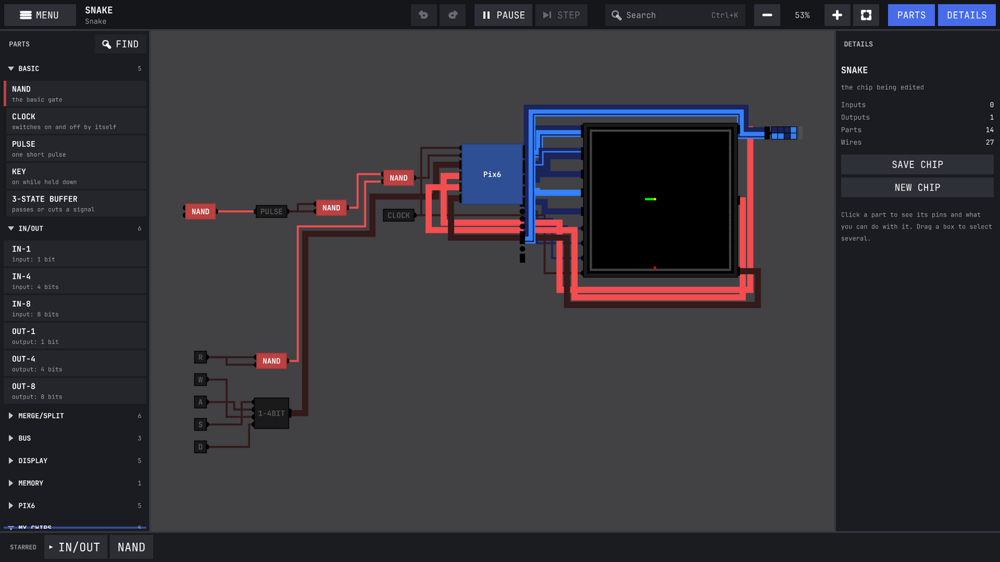
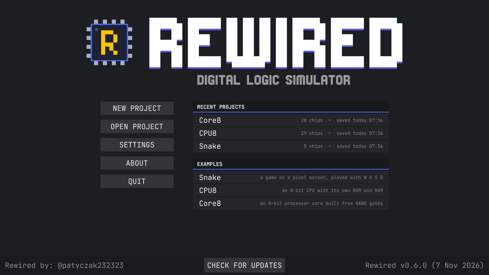
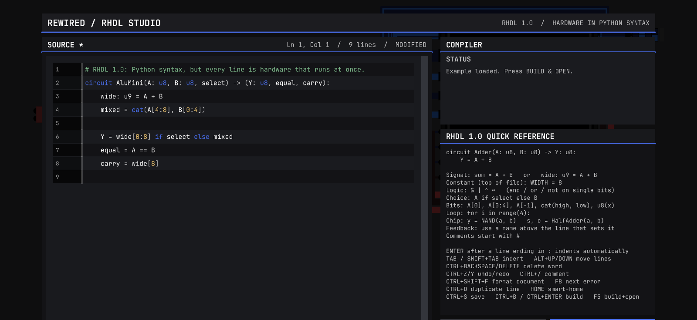
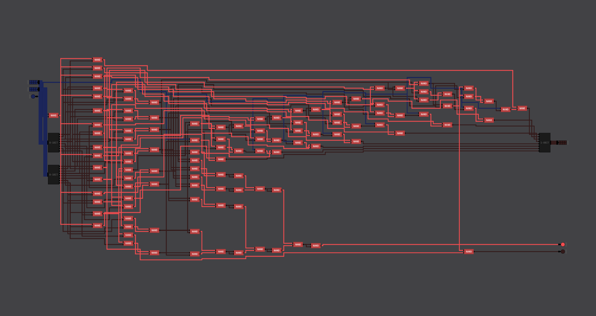

<p align="center"></p>

<h1 align="center">Rewired</h1>

<p align="center">
A digital logic simulator. Start with NAND gates, end up with a CPU, then play Snake on it.<br>
Windows · Linux · Android · MIT
</p>

<p align="center">
<a href="https://github.com/patyczak232323/Rewired/releases/latest"></a>
<a href="https://github.com/patyczak232323/Rewired/releases"></a>
<a href="LICENSE"></a>
</p>

<p align="center"><a href="https://patyczak232323.github.io/Rewired/">Website</a> · <a href="https://patyczak232323.github.io/Rewired/play/">Play in the browser</a> · <a href="https://patyczak232323.github.io/Rewired/pl/">Po polsku</a></p>

<p align="center"></p>

Rewired is a fork of Sebastian Lague's [Digital Logic Sim](https://github.com/SebLague/Digital-Logic-Sim). The editor and the project format are still mostly his. The simulator underneath is new: it gives the same result every time and stays fast on big circuits like CPUs. On top of that there's a small hardware description language, a colour screen and an Android version.

## Download

**[Try it in your browser](https://patyczak232323.github.io/Rewired/play/)**, nothing to install. Or grab the latest build from [Releases](https://github.com/patyczak232323/Rewired/releases/latest):

- Windows: `DLSRewired-Windows-x64.zip`
- Linux: `DLSRewired-Linux-x86_64.zip`
- Browser: `DLSRewired-WebGL.zip` (unzip and put it on any static host)
- Android: `DLSRewired-Android-arm64.apk` (still experimental)

On Linux you may need to make it executable first:

```bash
chmod +x DLSRewired
./DLSRewired
```

The app checks for new releases on startup and can update itself on Windows, Linux and Android. You can turn that off in Settings. If the install folder isn't writable it just opens the release page. On Android the first update asks for permission to install apps; after that it's one tap.

## What's in it

- The usual editor: place gates, wire them up, pack them into your own chips, nest those as deep as you like.
- A rewritten simulator. It's deterministic, so the same circuit does the same thing every time. Combinational parts get compiled (JIT) and small ones get cached as lookup tables, which makes big designs a lot faster.
- RHDL, a small language for describing chips in text (more below).
- Truth tables for combinational chips. You can save one as a test.
- Breakpoints on pins: stop when a pin changes, rises, falls or hits a value.
- Waveforms, replay and some diagnostics for when a circuit won't settle.
- A 64×64 colour screen (4 bits per channel, double-buffered).
- Export to Verilog, SVG and PNG.
- Ctrl+K searches parts and commands, F1 lists every shortcut.
- A touch UI for phones and tablets, with on-screen keys so you can play Snake without a keyboard.

<p align="center"></p>

## Example projects

Three projects get installed the first time you start Rewired. All of them are NAND gates all the way down.

- **Snake**: a small processor (PIX6) driving the 64×64 screen. Open it, press run, use W A S D.
- **CPU8**: an 8-bit single-cycle CPU with its own ROM and RAM.
- **Core8**: an 8-bit processor core.

## RHDL

Wiring up a 16-bit adder by hand gets old fast. With RHDL you describe a chip in a few lines and RHDL Studio turns it into a normal Rewired chip made of NANDs and your other chips. There's no separate runtime, the result is just a circuit you can open and poke at.

```text
chip FullAdder
    in A, B, CIN
    out SUM, COUT

    ab = A xor B
    SUM = ab xor CIN
    COUT = (A and B) or (CIN and ab)
```

| RHDL Studio | What it builds |
|---|---|
|  |  |

What it can do:

- `and`, `or`, `xor`, `not`, `nand`, `nor`, `xnor`, plus `+ -`, comparisons and `<< >>`
- `if s then a else b` for muxes
- bit indexing and ranges (`A[3]`, `A[0..3]`), `join(...)` to build buses
- `for i in 0..7 ... end` loops, handy for ripple-carry adders and the like
- calling other chips like functions: `q, nq = DffBit(d, clk)`
- feedback: you can use a name before the line that assigns it, which is how latches and registers are written

## Compatibility with Digital Logic Sim

Most DLS projects open fine, but don't expect them to behave exactly the same. If a circuit relied on evaluation order, races or odd startup states in feedback loops, it may act differently here. That's on purpose: one predictable answer beats whatever order the original happened to visit gates in.

If you find a circuit that clearly behaves wrong, please open an issue and attach the project. Sequential stuff, feedback loops and big nested chips are the most useful to see.

## How the simulator works

This part is for people who want the details. Everything lives in `Assets/Scripts/Simulation`; the editor talks to it only through `RewiredEngine`.

### The netlist

When a project opens, or the circuit changes, the chip tree is flattened once into plain arrays (`DeterministicSimulator.EnsureTopology`):

- every pin gets an index, and the wires become two **compressed sparse row** tables: for each source pin the range of target pins it drives, and for each target pin the range of pins driving it. Propagation then walks contiguous `int[]` ranges instead of one managed array per pin;
- the pins of a plain **NAND** gate (most of any circuit) are looked up once, so evaluating one is `1 ^ (a.State & b.State & 1)` with no per-gate type switch;
- custom-chip boundary pins that have a single driver are **pass-through** pins. They are resolved immediately when their driver changes, recursively up to depth 64, instead of taking a trip through the queue. Wires have no delay, so the result and the delta cycle it lands in are the same either way.

A pin state is one `uint`: up to 16 bit values in the low half and a tri-state flag per bit in the high half.

### One simulation step

`RunSimulationStep` does, in order:

1. copy the input pins the user set into the netlist;
2. update the **frame sources**: clocks (high or low from `frame / stepsPerClockTransition`) and KEY chips;
3. **settle** the combinational logic;
4. advance the **sequential** parts: PULSE timers and the displays (on a clock edge the 64×64 screen writes a pixel into its back buffer, and copies that to the picture shown when REFRESH is high);
5. settle again;
6. update buzzers, record waveforms and replay data.

### Settling: delta cycles

Settling is event driven and runs in **delta cycles**. Changed pins queue the pins they drive (a ring buffer, each pin at most once); resolving a target marks the chip that owns it dirty. Each delta cycle then evaluates every dirty chip against the current pin states and **stages** the results, and only after the whole batch are the staged outputs **committed** and their fan-out queued for the next cycle. All gates in a cycle therefore switch at the same time, so the result never depends on the order gates happen to be visited in. That is the main difference from the original Digital Logic Sim.

A circuit that does not settle is stopped after `max(256, chips + 64)` delta cycles, or when one chip is evaluated more than 256 times in one settle, and the diagnostics name the chips involved.

A pin driven by several sources (a bus with tri-state buffers) is resolved bit by bit: a tri-stated driver never wins, and on a real conflict between two active drivers one bit value is picked at random and the contention is reported.

### Power-on

A circuit that has just been built has no history, so a latch made of two NANDs has no defined state. On power-on (only for a new root circuit, never on an edit) every chip is marked dirty and evaluated one at a time in a **random order**, each result committed immediately, until nothing changes or a budget of `max(4096, 512 × chips)` evaluations runs out. That models the tiny delay differences that decide which side of a real latch wins. No clock edge, RAM write or pulse is created during power-on.

### Accelerators

Three accelerators replace whole custom chips once they are proven equivalent. Each one is chosen per chip, falls back to the gate-level engine when it does not apply, and is checked against it by the tests.

- **FULL LUT** (`CombinationalChipCache`). A pure combinational chip (no state, no feedback, one driver per net) with at most 24 input bits gets a lookup table of all its outputs, built on a background thread (in parallel chunks of 4096 entries for big tables). Evaluating the chip is then one array read. Tables are saved per project in `Cache/FullLUT/*.dlscache`, keyed by a SHA-256 fingerprint of the chip's logic including every nested chip, so a table is reused across sessions and thrown away as soon as anything inside changes.
- **Combinational JIT** (`CombinationalJitCompiler`). Chips that pass the same analysis are also flattened into a list of primitive operations over slots of a `uint[]`, sorted topologically and emitted as IL with `DynamicMethod` (256 operations per method), which the runtime compiles to machine code. One evaluation is one straight-line function call. It runs the chip whenever no table is ready: while one is being built, and for good when the chip has too many inputs or the table would be too big.
- **Feedback JIT** (`FeedbackJitCompiler`). Chips with loops (latches, registers, counters, up to 1024 primitives) are flattened the same way, but run as **sweeps**: each sweep reads the previous state array and writes the next one, exactly like a delta cycle evaluates every gate at once, and sweeps repeat until nothing changes. They run on the `GateProgram` interpreter below on every platform, desktop included, because it **settles** them by evaluating only what changes: generated code that evaluated every gate in every sweep was about half as fast on Snake and Core8. If the inputs did not change since the last converged state, the chip is not evaluated at all. A program that does not converge within `max(256, primitives + 64)` sweeps is switched off for that chip and the gate-level engine takes over.

### Android and the browser: the gate program interpreter

The combinational JIT needs to generate code while the app runs. Android and WebGL builds are compiled ahead of time with **IL2CPP**, which cannot do that, so those platforms run the same compiled operation lists on an interpreter, `GateProgram`, which also runs every feedback chip:

- the operations are encoded as one `int[]` stream with constants in a separate table. Consecutive NANDs of two slots (most of a program) form a **run** that a tight loop executes without a `switch`: `write[d] = ((read[a] & read[b]) ^ 1) & 1`. Every other operation (tri-state buffer, bus split and merge, 4+4→8 merge, copy) is a line-by-line translation of the IL the JIT emits;
- for feedback chips the interpreter does not run full sweeps. It **settles**: the first sweep after the chip is synchronised evaluates every operation, after that each sweep evaluates only the operations that read a slot that changed in the sweep before, and all results of a sweep are committed together. An operation whose inputs did not change would only recompute the value it already holds, so after every sweep the state is identical to what full sweeps give, including the number of sweeps reported and the state left behind when a chip does not converge;
- IL2CPP builds pick the interpreter for combinational chips up front (`ENABLE_IL2CPP`), and every other platform falls back to it if creating a `DynamicMethod` fails;
- the hottest loops (the interpreter and the delta-cycle core) are marked with `Il2CppSetOption` to drop IL2CPP's null and array-bounds checks. Every index used there comes from tables the engine built for exactly those arrays.

The desktop builds (Mono) keep generated machine code for combinational chips. For feedback chips settling beat it: on the example projects Snake ran about 1.6× and Core8 about 1.9× faster with settling than with generated full sweeps, and CPU8 the same.

How the interpreter is checked:

- every combinational chip of the example projects, plus a chip that uses every primitive the compilers support, is compiled both ways and both programs get the same random signals (tri-state flags and constants included), compared slot by slot;
- the settling executor and a full-sweep executor of the same program run side by side on random input sequences, compared after every step: outputs, convergence, sweep count and the state of every gate, including a ring oscillator that never settles;
- feedback chips are compared against the gate-level engine (the accelerator equivalence and CPU tests);
- the whole test suite runs a second time with every program interpreted (`REWIRED_FORCE_INTERPRETER=1`);
- the tests themselves were checked by deliberately breaking each operation of the interpreter and each step of the settling logic, one at a time: every break makes them fail, except one change that turned out to give identical results anyway (treating a state that did not converge as settled: the operations still marked from its last sweep are exactly the ones a full sweep would change).

### Threads

On the desktop and Android the simulation runs on its own thread and paces itself to the target steps per second: it sleeps when the remaining wait is 0.25 ms or more and only yields for shorter gaps. In the browser there are no threads, so the simulation runs inside each frame for up to 10 ms.

The speed is set in Preferences as one **clock speed in Hz**, or **MAX** for no limit. Projects keep storing it the way Digital Logic Sim does, as steps per second plus steps per clock tick (the clock changes level every that many steps), and the Hz value is converted with the project's steps per clock tick. Every step settles the whole circuit, so steps between clock edges do no work and only the clock speed decides how fast a circuit runs. Steps per clock tick is no longer shown; it stays as saved because PULSE chips count their length in steps. MAX is stored as the largest step rate, so older versions open such a project as "as fast as possible" as well.

There is one clock speed for all projects, kept in the app settings (2 Hz to start with). In Preferences, **Clock speed for** says whether the project follows it (**All Projects**) or has a speed of its own (**This Project**). The examples have their own: Snake is a game and runs at 4000 Hz, CPU8 and Core8 at 10 Hz. A project saved by an older version keeps its own speed when it differs from the shared one, so updating never changes how fast a project runs. The project file still stores the step rate it runs at, so older versions open it at the same speed.

The main thread reads the keyboard once a frame and publishes the held keys as an **immutable snapshot**. The simulation thread asks about every KEY chip on every step and only reads that reference, so the two threads never wait on a lock for it.

### The RHDL compiler

`RhdlCompiler` parses the source, elaborates it into a netlist of bits (`RhdlElaborator`), turns that into an ordinary chip, and draws it with a layered (Sugiyama) layout (`RhdlLayout`): columns by longest path with feedback wires reversed, crossings reduced by barycentre ordering, vertical positions by isotonic regression, and a track for every vertical wire segment. The layout was most of the compile time; three quadratic steps are now near-linear with exactly the same output:

- crossings between two columns are counted as inversions with a merge sort instead of comparing every pair of wires;
- the "this wire must use a track left of that one" constraints are found through 0.001-wide height buckets instead of comparing every pair of wire heights, keeping the order the constraints are added in;
- parts without inputs and latch pairs are found from precomputed sets instead of rescanning every wire for every part.

The output was compared byte for byte on all 708 chips the tests compile, before and after.

### Measured speed

The engine tests in `Tools/EngineTests` include benchmarks of the bundled projects. Measured with .NET 8 on an x86-64 Linux machine (release build, median of 7 runs). A phone is slower in absolute terms, but the ratios between the paths carry over:

| Project | IL2CPP before (LUT only) | IL2CPP now (interpreter) | Desktop (JIT) |
| --- | ---: | ---: | ---: |
| Snake | 24,200 steps/s | 49,200 steps/s (2.0×) | 40,200 steps/s |
| CPU8 | 710 steps/s | 6,570 steps/s (9.3×) | 11,100 steps/s |
| Core8 | 61,300 steps/s | 174,500 steps/s (2.8×) | 138,200 steps/s |

Compiling the PIX6 processor (1565 gates) from RHDL went from about 690 ms to about 200 ms.

### Tests

`Tools/EngineTests` builds the engine, RHDL and the save system with plain .NET (stand-ins for the few Unity types are in `Stubs/`) and runs 187 NUnit tests in about half a minute, without starting Unity:

```bash
dotnet test Tools/EngineTests --filter "Category!=Benchmark"                                # tests
REWIRED_FORCE_INTERPRETER=1 dotnet test Tools/EngineTests --filter "Category!=Benchmark"    # same, on the IL2CPP path
dotnet test Tools/EngineTests --filter "Category=Benchmark"                                 # benchmarks
```

The tests live outside `Assets/`, so Unity never imports them and the app builds are unaffected. The RHDL sources the example projects were built from are in `Tools/EngineTests/Fixtures`. The benchmarks fail when the work per step (gate evaluations, propagations) grows more than 25% over `benchmark-baseline.json`, which catches an accelerator that silently stops engaging. CI (`engine-tests.yml`) runs all three on GitHub-hosted runners, so the self-hosted machine stays free for the Unity builds.

## Building

You need the Unity version from `ProjectSettings/ProjectVersion.txt`.

```bash
git clone https://github.com/patyczak232323/Rewired.git
```

Then open the folder in Unity Hub.

Release builds run on GitHub Actions on self-hosted runners (`Tools/SelfHostedRunners` has the setup script). The workflows need `UNITY_LICENSE`, `UNITY_EMAIL`, `UNITY_PASSWORD`, and for Android `ANDROID_KEYSTORE_BASE64`, `ANDROID_KEYSTORE_PASS`, `ANDROID_KEYALIAS_NAME`, `ANDROID_KEYALIAS_PASS`.

- Every push to `main` updates the `android-unofficial` pre-release with fresh builds (`unofficial-build.yml`).
- Changes to the engine run the engine tests (`engine-tests.yml`, see [Tests](#tests)).
- `pages.yml` publishes the website in `site/` to GitHub Pages, with the browser build from the latest release under `play/`. It runs after every release and when `site/` changes.
- For a release: bump the version in `VERSION`, `Main.RewiredVersion` and `bundleVersion` in `ProjectSettings/ProjectSettings.asset`, merge to `main` and run `release.yml` (or push a `v*` tag matching `VERSION`).

Current version: 0.8.2.

## Status

Work in progress. The example projects run fine, but big stateful circuits can still hit bugs nobody has found yet.

## Credits and license

Huge thanks to [Sebastian Lague](https://github.com/SebLague) for Digital Logic Sim, which this is built on.

MIT, see [LICENSE](LICENSE).
